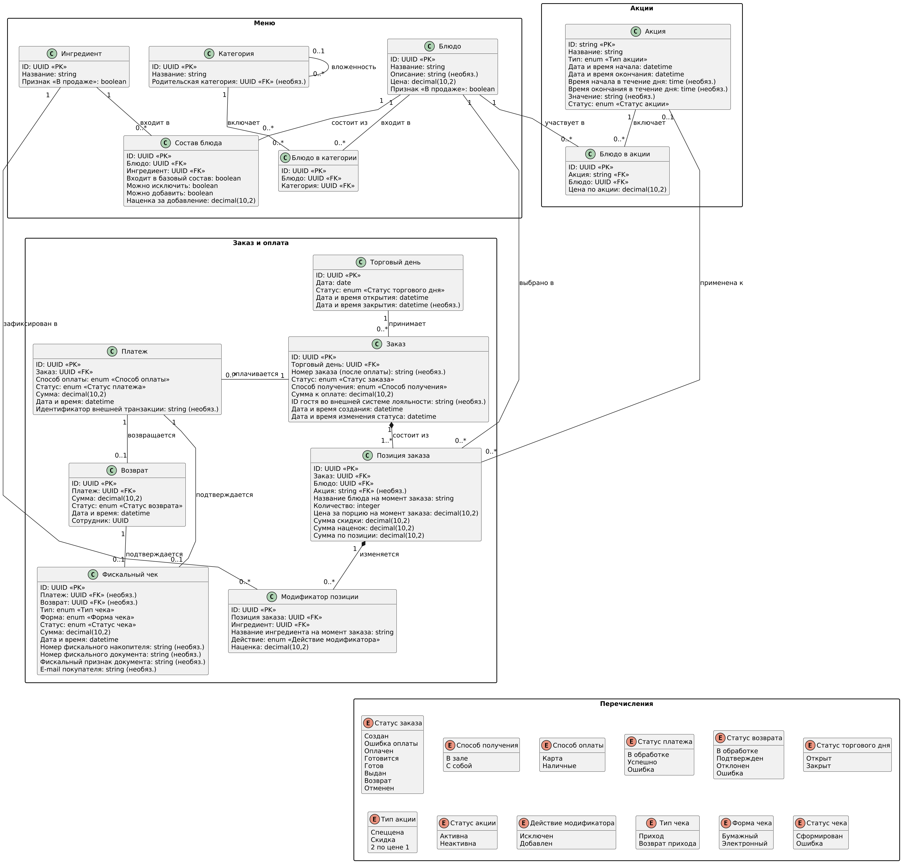

# 3.2. Диаграмма классов

На [рисунке 3.1](#risunok-3-1) приведена диаграмма классов в нотации PlantUML. Классы приведены без операций: модель описывает состав данных. Связи показывают логические зависимости. Ссылки на исходный код схем PlantUML приведены в [Приложении А](../prilozhenie-a.md).

Рисунок 3.1 — Диаграмма классов информационной модели
{: #risunok-3-1 .caption }
