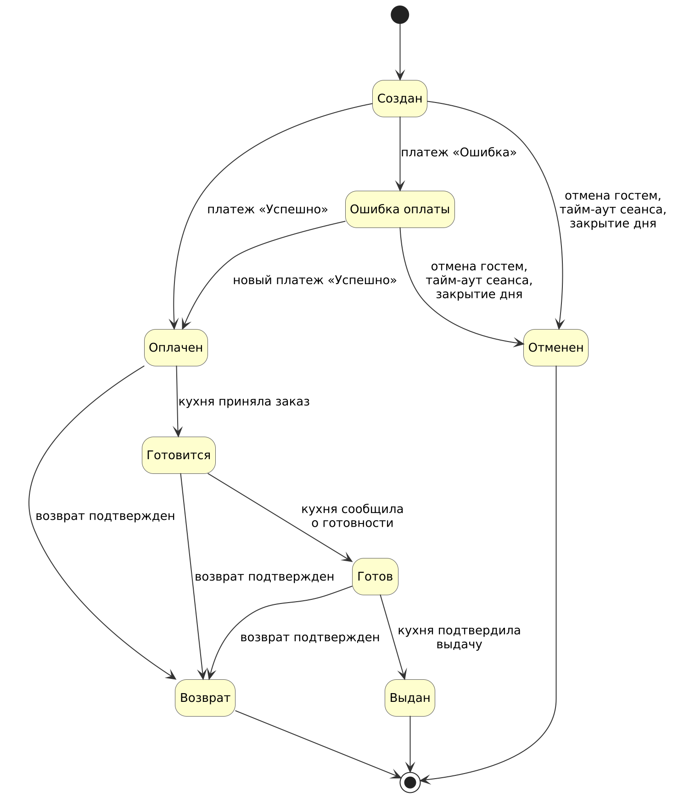
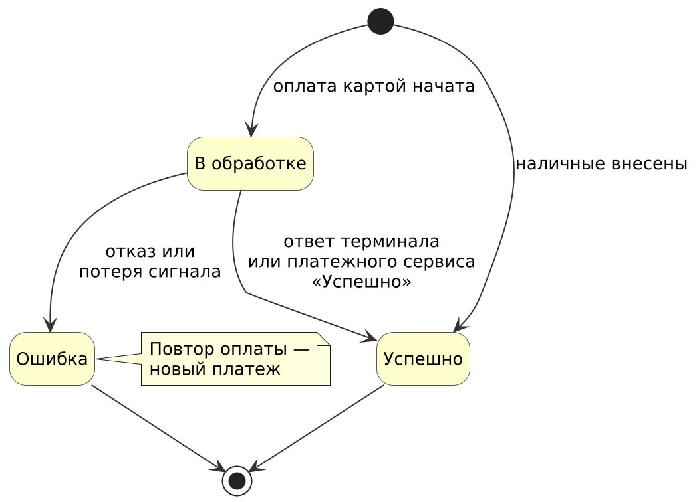
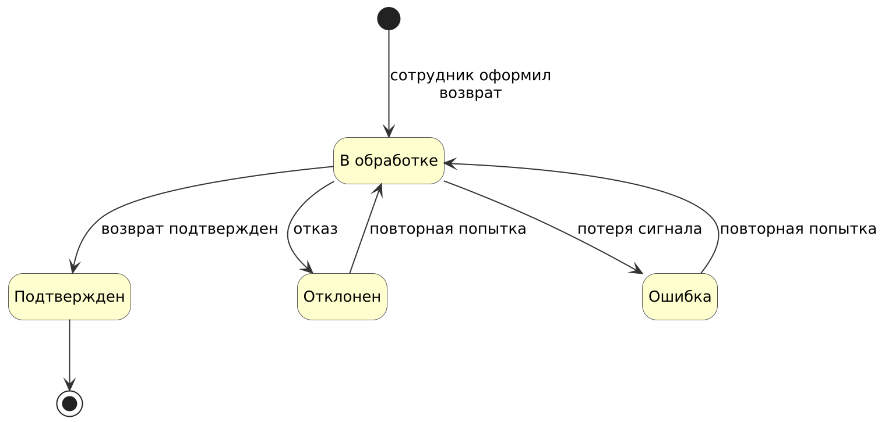

# 3.5. Перечисления и статусные модели

Перечисления в [таблице 3.3](#tablitsa-3-3) задают допустимые значения атрибутов.

Таблица 3.3 — Перечисления и статусы
{: #tablitsa-3-3 .caption }

| Перечисление | Значения | Основание |
| --- | --- | --- |
| Статус заказа | Создан Ошибка оплаты Оплачен Готовится Готов Выдан Возврат Отменен | [ПР-09](../02-trebovaniya/2.3-ogranicheniya-i-pravila.md#pr-09) «Ответ терминала оплаты» [ПР-10](../02-trebovaniya/2.3-ogranicheniya-i-pravila.md#pr-10) «Отмена и повтор оплаты» [ПР-12](../02-trebovaniya/2.3-ogranicheniya-i-pravila.md#pr-12) «Статусы производства и выдачи» [ПР-13](../02-trebovaniya/2.3-ogranicheniya-i-pravila.md#pr-13) «Оплата наличными» [ПР-15](../02-trebovaniya/2.3-ogranicheniya-i-pravila.md#pr-15) «Возврат оплаты» [ПР-17](../02-trebovaniya/2.3-ogranicheniya-i-pravila.md#pr-17) «Прием заказов в открытый торговый день» |
| Способ получения | В зале С собой | [US-05](../06-zadachi/6.3-istorii-mvp.md#us-05) «Выбор способа получения» [ПР-18](../02-trebovaniya/2.3-ogranicheniya-i-pravila.md#pr-18) «Создание заказа» |
| Способ оплаты | Карта Наличные | [US-08](../06-zadachi/6.3-istorii-mvp.md#us-08) «Оплата заказа» [ПР-13](../02-trebovaniya/2.3-ogranicheniya-i-pravila.md#pr-13) «Оплата наличными» |
| Статус платежа | В обработке Успешно Ошибка | [ПР-09](../02-trebovaniya/2.3-ogranicheniya-i-pravila.md#pr-09) «Ответ терминала оплаты» [ПР-13](../02-trebovaniya/2.3-ogranicheniya-i-pravila.md#pr-13) «Оплата наличными» |
| Статус возврата | В обработке Подтвержден Отклонен Ошибка | [US-12](../06-zadachi/6.3-istorii-mvp.md#us-12) «Возврат оплаты» [ПР-15](../02-trebovaniya/2.3-ogranicheniya-i-pravila.md#pr-15) «Возврат оплаты» |
| Тип чека | Приход Возврат прихода | [ПР-24](../02-trebovaniya/2.3-ogranicheniya-i-pravila.md#pr-24) «Фискальный чек» |
| Форма чека | Бумажный Электронный | [US-16](../06-zadachi/6.4-istorii-reliza-1.md#us-16) «Заказ в мобильном приложении» [ПР-24](../02-trebovaniya/2.3-ogranicheniya-i-pravila.md#pr-24) «Фискальный чек» |
| Статус чека | Сформирован Ошибка | [US-08](../06-zadachi/6.3-istorii-mvp.md#us-08) «Оплата заказа» [ПР-24](../02-trebovaniya/2.3-ogranicheniya-i-pravila.md#pr-24) «Фискальный чек» |
| Статус торгового дня | Открыт Закрыт | [US-13](../06-zadachi/6.3-istorii-mvp.md#us-13) «Управление торговым днем» [ПР-17](../02-trebovaniya/2.3-ogranicheniya-i-pravila.md#pr-17) «Прием заказов в открытый торговый день» |
| Тип акции | Спеццена Скидка 2 по цене 1 | [US-06](../06-zadachi/6.3-istorii-mvp.md#us-06) «Применение акции» [ПР-03](../02-trebovaniya/2.3-ogranicheniya-i-pravila.md#pr-03) «Период действия акции» |
| Статус акции | Активна Неактивна | [US-06](../06-zadachi/6.3-istorii-mvp.md#us-06) «Применение акции» [ПР-03](../02-trebovaniya/2.3-ogranicheniya-i-pravila.md#pr-03) «Период действия акции» |
| Действие модификатора | Исключен Добавлен | [US-03](../06-zadachi/6.3-istorii-mvp.md#us-03) «Изменение состава блюда» |

Переходы между статусами заказа приведены на [рисунке 3.2](#risunok-3-2), платежа — на [рисунке 3.3](#risunok-3-3), возврата — на [рисунке 3.4](#risunok-3-4).

Рисунок 3.2 — Статусная модель заказа
{: #risunok-3-2 .caption }

Рисунок 3.3 — Статусная модель платежа
{: #risunok-3-3 .caption }

Рисунок 3.4 — Статусная модель возврата
{: #risunok-3-4 .caption }

Оплата и ошибки оплаты заданы в [ПР-09](../02-trebovaniya/2.3-ogranicheniya-i-pravila.md#pr-09) «Ответ терминала оплаты» и [ПР-13](../02-trebovaniya/2.3-ogranicheniya-i-pravila.md#pr-13) «Оплата наличными», отмена и повтор оплаты — в [ПР-10](../02-trebovaniya/2.3-ogranicheniya-i-pravila.md#pr-10) «Отмена и повтор оплаты», приготовление и выдача — в [ПР-12](../02-trebovaniya/2.3-ogranicheniya-i-pravila.md#pr-12) «Статусы производства и выдачи», возврат — в [ПР-15](../02-trebovaniya/2.3-ogranicheniya-i-pravila.md#pr-15) «Возврат оплаты», отмена заказов при закрытии дня — в [ПР-17](../02-trebovaniya/2.3-ogranicheniya-i-pravila.md#pr-17) «Прием заказов в открытый торговый день». Статусы заказа «Выдан», «Возврат» и «Отменен» конечные. Повтор оплаты создает новый платеж, повторная попытка возврата выполняется по тому же возврату.
