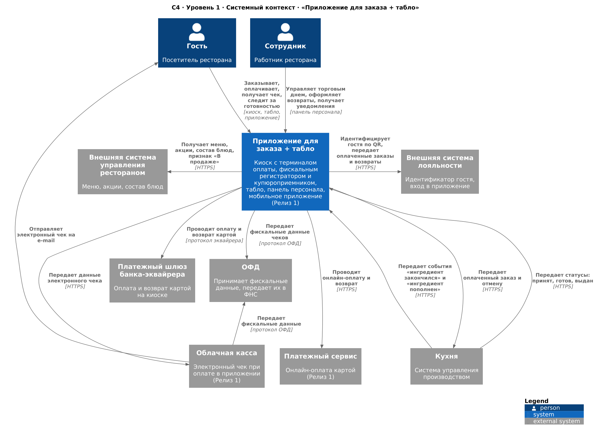
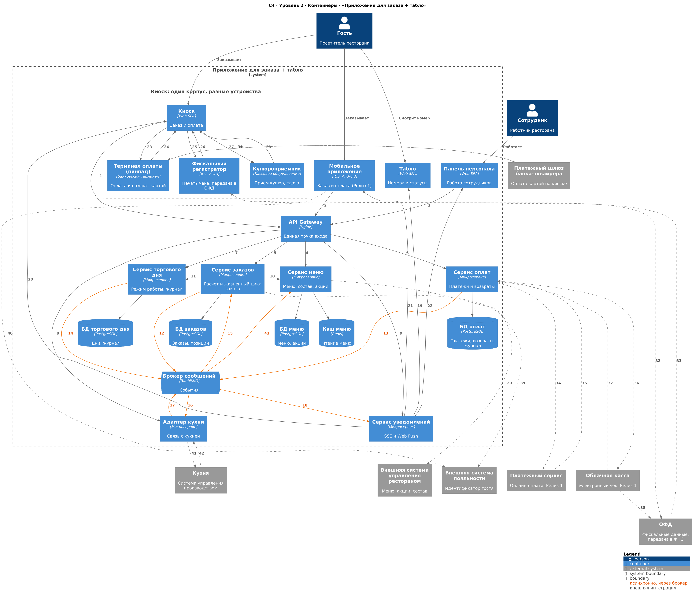
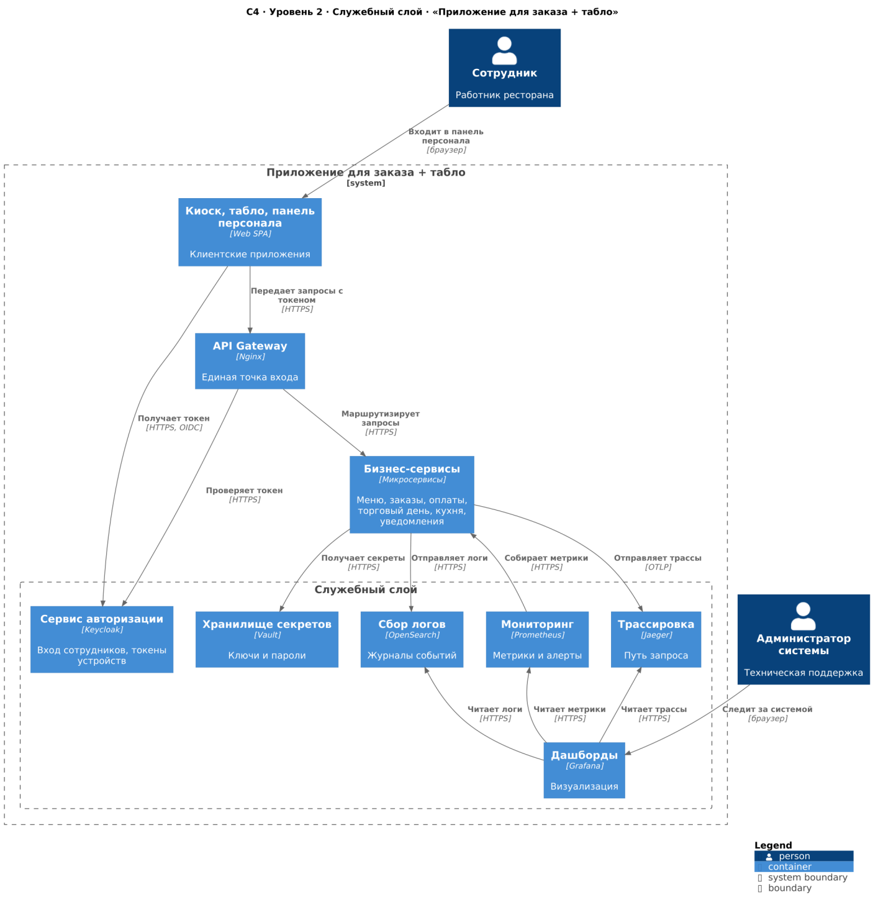

# 4.2. Диаграмма компонентов

Системный контекст приведен на [рисунке 4.1](#risunok-4-1), контейнеры системы — на [рисунке 4.2](#risunok-4-2), служебный слой — на [рисунке 4.3](#risunok-4-3). Номера стрелок на [рисунке 4.2](#risunok-4-2) совпадают с номерами потоков в таблицах [4.4](4.3-perechen-integraciy.md#tablitsa-4-4) и [4.5](4.3-perechen-integraciy.md#tablitsa-4-5). Обращения сервисов к своим БД и кэшу номеров не имеют.

Киоск на [рисунке 4.2](#risunok-4-2) показан границей: приложение киоска, терминал оплаты (пинпад), фискальный регистратор и купюроприемник находятся в одном корпусе, но это разные устройства. Сканер QR тоже входит в киоск, на схеме он не показан.

Рисунок 4.1 — Системный контекст, уровень 1
{: #risunok-4-1 .caption }

Рисунок 4.2 — Контейнеры системы, уровень 2
{: #risunok-4-2 .caption }

Рисунок 4.3 — Служебный слой, уровень 2
{: #risunok-4-3 .caption }

Назначение компонентов приведено в [таблице 4.2](#tablitsa-4-2).

Таблица 4.2 — Компоненты системы
{: #tablitsa-4-2 .caption }

| Компонент | Тип, технология | Назначение | С чем взаимодействует |
| --- | --- | --- | --- |
| Киоск | Web SPA, драйверы устройств киоска | Оформление и оплата заказа гостем | API Gateway — меню, проверка корзины, заказ, оплата, результаты возврата и печати чеков Сервис уведомлений — режим работы, статус заказа, команды возврата и печати чека возврата (SSE) Терминал оплаты, фискальный регистратор, купюроприемник, сканер QR |
| Терминал оплаты (пинпад) | Банковский терминал в корпусе киоска | Оплата и возврат картой | Киоск, платежный шлюз банка-эквайрера |
| Фискальный регистратор | ККТ с фискальным накопителем в корпусе киоска | Печать фискального чека с номером заказа и чека возврата | Киоск, ОФД |
| Купюроприемник | Кассовое оборудование киоска | Прием купюр, выдача сдачи, возврат внесенных купюр | Киоск |
| Мобильное приложение (Релиз 1) | iOS, Android | Заказ, онлайн-оплата и статус заказа гостя | API Gateway — меню, акции, заказ, оплата с e-mail для электронного чека Сервис уведомлений — статус и номер заказа (SSE) Внешняя система лояльности — вход гостя |
| Табло | Web SPA | Номера и статусы заказов | Сервис уведомлений — номера и статусы (SSE) |
| Панель персонала | Web SPA | Рабочее место сотрудника | API Gateway — торговый день, заказы, возвраты, повтор передачи на кухню Сервис уведомлений — уведомления о сбоях (Web Push) |
| API Gateway | Nginx | Единая точка входа | Маршрутизирует запросы клиентов в сервисы, проверяет токен в Сервисе авторизации |
| Сервис меню | Микросервис, PostgreSQL, Redis | Категории, блюда, состав, наценки, акции | Получает меню, акции и состав из внешней системы управления рестораном и обновляет признак «В продаже» по событиям кухни, отдает меню клиентам и Сервису заказов |
| Сервис заказов | Микросервис, PostgreSQL | Проверка корзины, расчет и создание заказа, статусы и номер заказа | Сервис меню — цены, акции, состав Сервис торгового дня — статус дня Брокер — события заказа Внешняя система лояльности — идентификация по QR, оплаченные заказы, возвраты |
| Сервис оплат | Микросервис, PostgreSQL | Платежи и возвраты, фискальные чеки, журнал возвратов | Киоск — платежи, ответы терминала, фискальные чеки Платежный сервис — онлайн-оплата (Релиз 1) Облачная касса — электронные чеки (Релиз 1) Брокер — результаты платежей и возвратов, сбои печати чека |
| Сервис торгового дня | Микросервис, PostgreSQL | Открытие и закрытие дня, журнал операций дня | Панель персонала, Сервис заказов, брокер — события дня |
| Адаптер кухни | Микросервис | Передача оплаченных заказов на кухню, прием статусов и событий об окончании и пополнении ингредиентов | Брокер, кухня, Панель персонала — повтор передачи |
| Сервис уведомлений | Микросервис | Доставка статусов и уведомлений клиентам | Брокер; табло, киоск, мобильное приложение (SSE); панель персонала (Web Push) |
| Брокер сообщений | RabbitMQ | Доставка событий | Сервисы заказов, оплат, торгового дня, меню, Адаптер кухни, Сервис уведомлений |
| Служебный слой | Keycloak, Vault, OpenSearch, Prometheus, Jaeger, Grafana | Вход и права, секреты, логи, метрики, трассировки | Все сервисы, [рисунок 4.3](#risunok-4-3) |

Журнал операций ([ПР-11](../02-trebovaniya/2.3-ogranicheniya-i-pravila.md#pr-11) «Журнал операций») ведет сервис, который выполняет операцию: Сервис торгового дня — открытие и закрытие дня, Сервис оплат — возвраты. Для Релиза 2 (оценки, отзывы, отчеты) добавляется отдельный сервис, на схемах он не показан.
