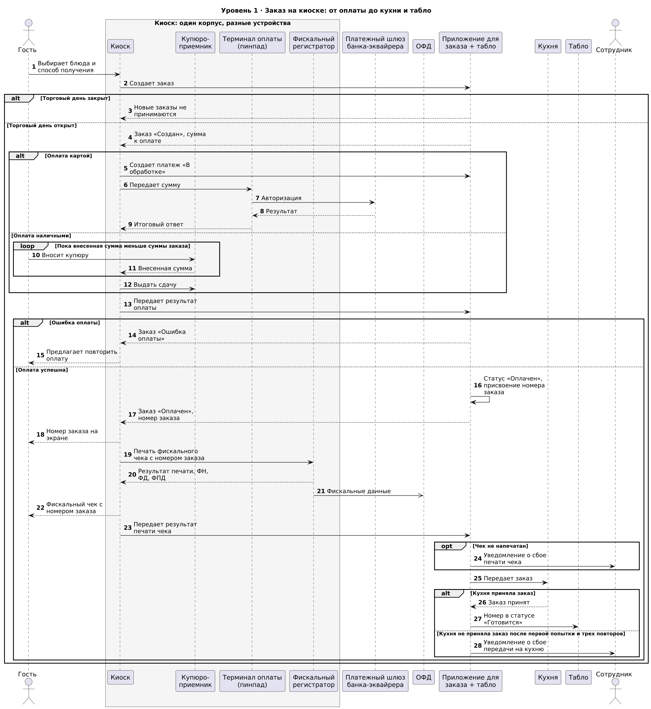
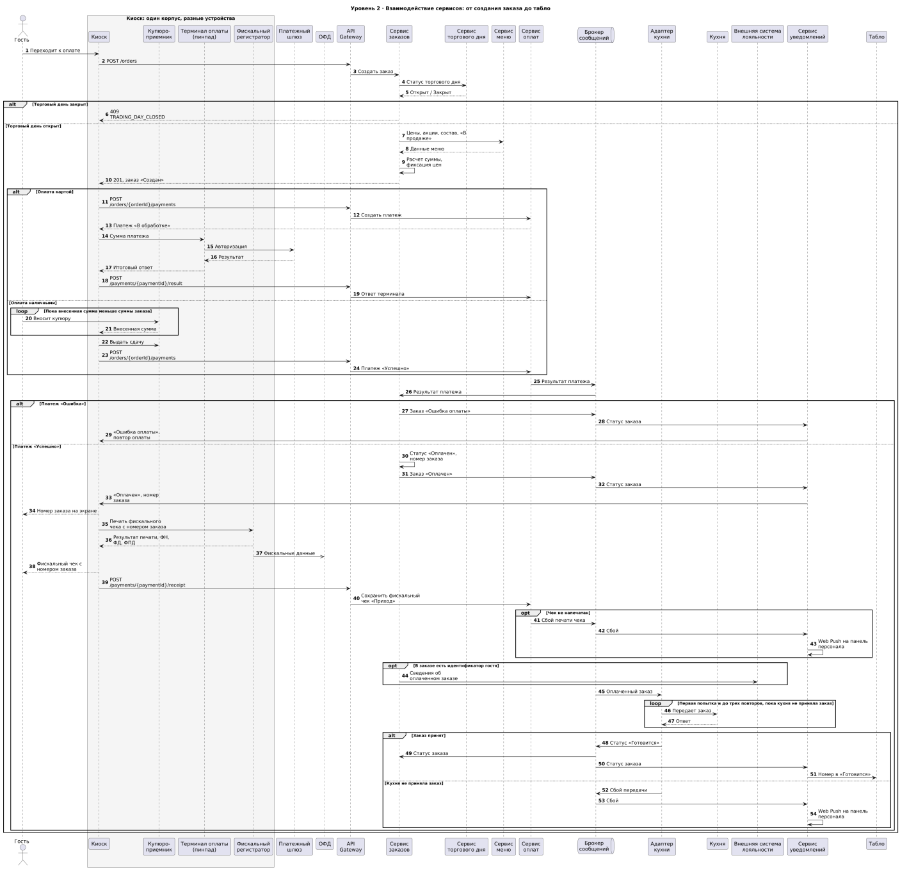

# 4.4. Схема и описание интеграции

Основной поток «заказ — оплата — фискальный чек — кухня — табло» приведен на [рисунке 4.4](#risunok-4-4) на уровне системы и на [рисунке 4.5](#risunok-4-5) на уровне сервисов.

Рисунок 4.4 — Заказ на киоске, уровень системы
{: #risunok-4-4 .caption }

Рисунок 4.5 — Взаимодействие сервисов от создания заказа до табло
{: #risunok-4-5 .caption }

Правила интеграций:

- создание заказа: киоск передает позиции с изменениями состава, способ получения и идентификатор гостя; Сервис заказов проверяет статус торгового дня, получает цены, акции и состав из Сервиса меню, рассчитывает сумму и фиксирует ее в позициях заказа ([ПР-05](../02-trebovaniya/2.3-ogranicheniya-i-pravila.md#pr-05) «Фиксация цены при создании заказа», [ПР-17](../02-trebovaniya/2.3-ogranicheniya-i-pravila.md#pr-17) «Прием заказов в открытый торговый день»);
- оплата картой: киоск создает платеж в статусе «В обработке» и передает сумму на терминал оплаты; терминал проводит операцию через платежный шлюз банка-эквайрера; киоск ждет итогового ответа без ограничения по времени ([ПР-09](../02-trebovaniya/2.3-ogranicheniya-i-pravila.md#pr-09) «Ответ терминала оплаты»); после ответа «Успешно» киоск передает ответ терминала в Сервис оплат; повторная передача того же ответа платеж не меняет ([НФТ-06](../02-trebovaniya/2.4-nefunkcionalnye-trebovaniya.md#nft-06) «Целостность повторной обработки»);
- оплата наличными: купюроприемник принимает купюры и выдает сдачу, платежный шлюз не участвует; когда сумма достаточна и сдачу можно выдать, киоск создает платеж со статусом «Успешно» ([ПР-13](../02-trebovaniya/2.3-ogranicheniya-i-pravila.md#pr-13) «Оплата наличными», [ПР-14](../02-trebovaniya/2.3-ogranicheniya-i-pravila.md#pr-14) «Нехватка сдачи»);
- номер заказа и фискальный чек: после успешного платежа Сервис заказов присваивает заказу номер и статус «Оплачен», Сервис уведомлений передает номер на киоск; киоск показывает номер на экране и дает фискальному регистратору команду напечатать чек с номером заказа; фискальный регистратор передает фискальные данные в ОФД, ОФД передает их в ФНС; результат печати с номером фискального накопителя, номером фискального документа и фискальным признаком киоск передает в Сервис оплат, который сохраняет фискальный чек ([ПР-16](../02-trebovaniya/2.3-ogranicheniya-i-pravila.md#pr-16) «Номер заказа», [ПР-24](../02-trebovaniya/2.3-ogranicheniya-i-pravila.md#pr-24) «Фискальный чек»);
- сбой печати чека: Сервис оплат сохраняет чек со статусом «Ошибка» и публикует сбой, на панели персонала появляется уведомление; статусы платежа и заказа не меняются, номер остается на экране киоска; передача на кухню начинается по статусу «Оплачен» и печати чека не ждет ([ПР-24](../02-trebovaniya/2.3-ogranicheniya-i-pravila.md#pr-24) «Фискальный чек»);
- оплата в мобильном приложении (Релиз 1): Сервис оплат проводит платеж в платежном сервисе; e-mail для электронного чека гость указывает в приложении при оплате; после успешной оплаты Сервис оплат передает в облачную кассу данные чека и этот e-mail, облачная касса формирует электронный чек, отправляет его на e-mail гостя и передает фискальные данные в ОФД; номер заказа приложение показывает на экране заказа;
- передача на кухню: Адаптер кухни получает оплаченные заказы из брокера и передает их на кухню в порядке времени успешной оплаты; если кухня не приняла заказ после первой попытки и трех повторов, адаптер публикует сбой для панели персонала ([ПР-08](../02-trebovaniya/2.3-ogranicheniya-i-pravila.md#pr-08) «Оплата до передачи на кухню», [ПР-12](../02-trebovaniya/2.3-ogranicheniya-i-pravila.md#pr-12) «Статусы производства и выдачи»);
- статусы кухни: кухня сообщает о приеме, готовности и выдаче заказа, Сервис заказов меняет статус, Сервис уведомлений рассылает его на табло, киоск и в мобильное приложение; сообщения после конечного статуса статус не меняют;
- доступность блюд: кухня передает события «ингредиент закончился» и «ингредиент пополнен», Адаптер кухни публикует их в брокер, Сервис меню снимает или возвращает признак «В продаже» у блюд с этим ингредиентом ([ПР-01](../02-trebovaniya/2.3-ogranicheniya-i-pravila.md#pr-01) «Настройка меню, акций и состава блюда во внешней системе»);
- возврат картой: Сервис оплат создает возврат и через брокер и Сервис уведомлений передает команду на киоск, на котором оплачен заказ; киоск проводит возврат на терминале оплаты через платежный шлюз банка-эквайрера, передает ответ терминала в Сервис оплат, печатает чек возврата на фискальном регистраторе и передает результат печати ([ПР-15](../02-trebovaniya/2.3-ogranicheniya-i-pravila.md#pr-15) «Возврат оплаты»);
- возврат наличными: деньги гостю выдает сотрудник и подтверждает возврат на панели персонала; Сервис оплат передает команду печати чека возврата на киоск, на котором оплачен заказ, киоск передает результат печати в Сервис оплат;
- возврат онлайн-оплаты (Релиз 1): деньги возвращает платежный сервис, чек возврата формирует облачная касса и отправляет его на e-mail, указанный гостем при оплате ([ПР-24](../02-trebovaniya/2.3-ogranicheniya-i-pravila.md#pr-24) «Фискальный чек»);
- внешняя система лояльности: Сервис заказов ждет ответа на идентификацию не больше 3с; ошибка или отсутствие ответа не блокирует заказ, заказ оформляется анонимно ([НФТ-16](../02-trebovaniya/2.4-nefunkcionalnye-trebovaniya.md#nft-16) «Тайм-аут внешней системы лояльности»); сведения об оплаченном заказе и возврате Сервис заказов передает повторно, пока внешняя система их не примет ([ПР-07](../02-trebovaniya/2.3-ogranicheniya-i-pravila.md#pr-07) «Идентификация по QR и анонимный заказ»);
- табло после восстановления связи запрашивает текущий список заказов и снова подписывается на события ([НФТ-10](../02-trebovaniya/2.4-nefunkcionalnye-trebovaniya.md#nft-10) «Восстановление актуальности табло»).
