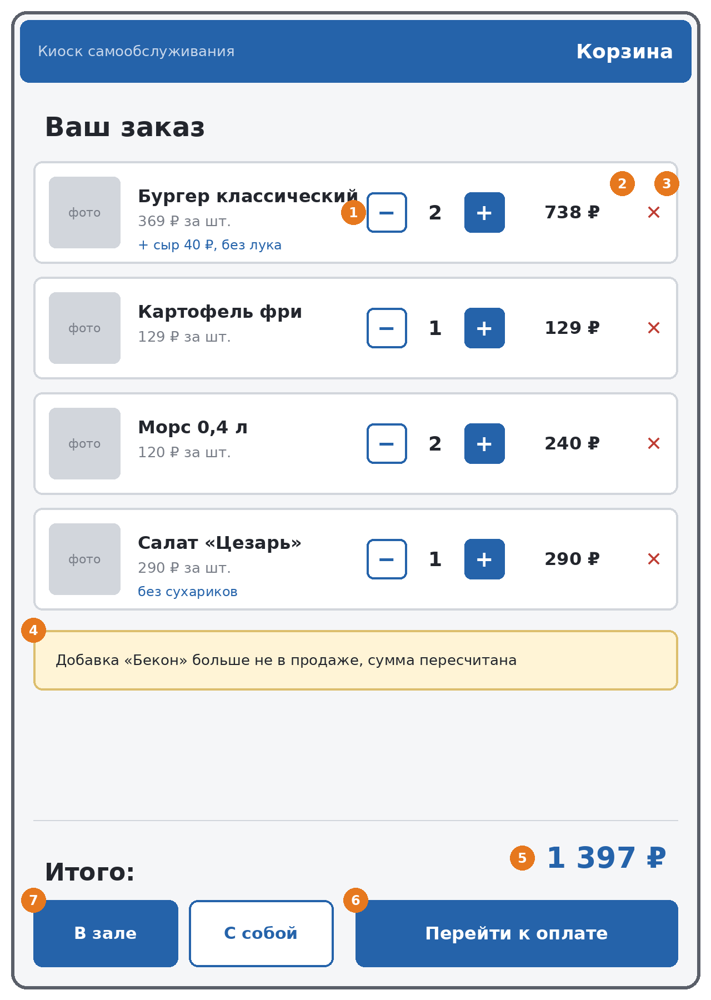
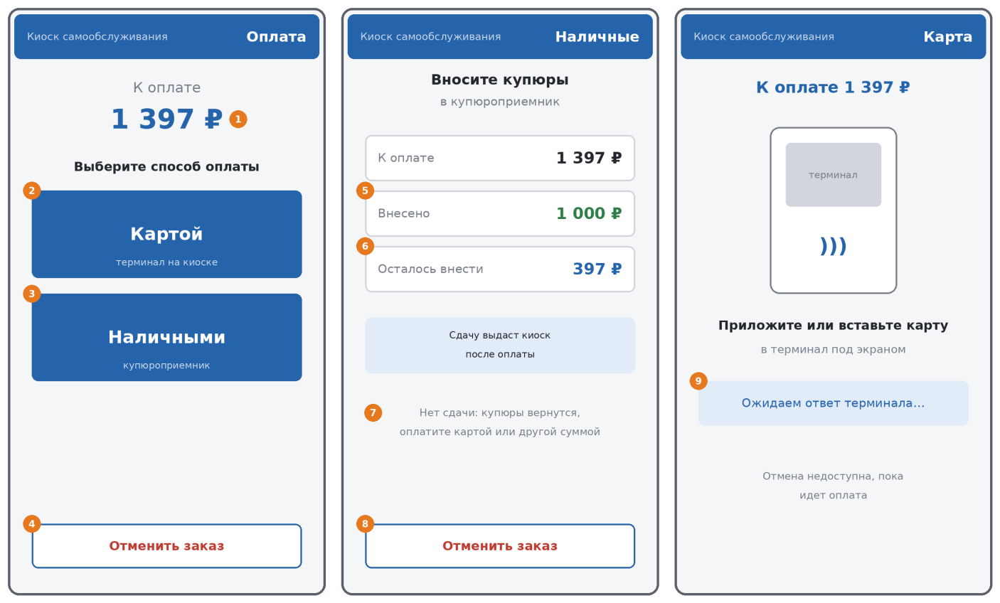
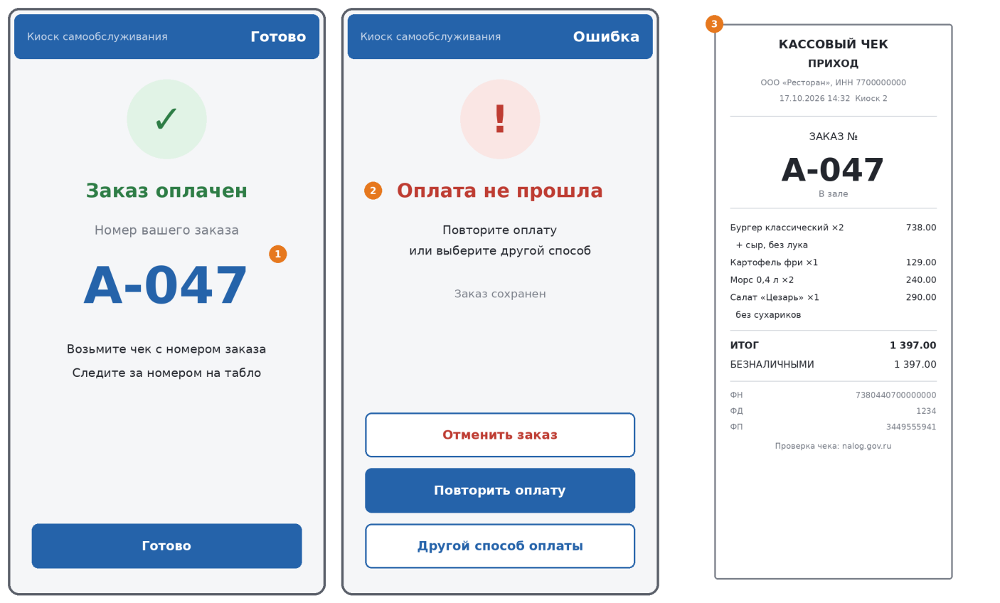
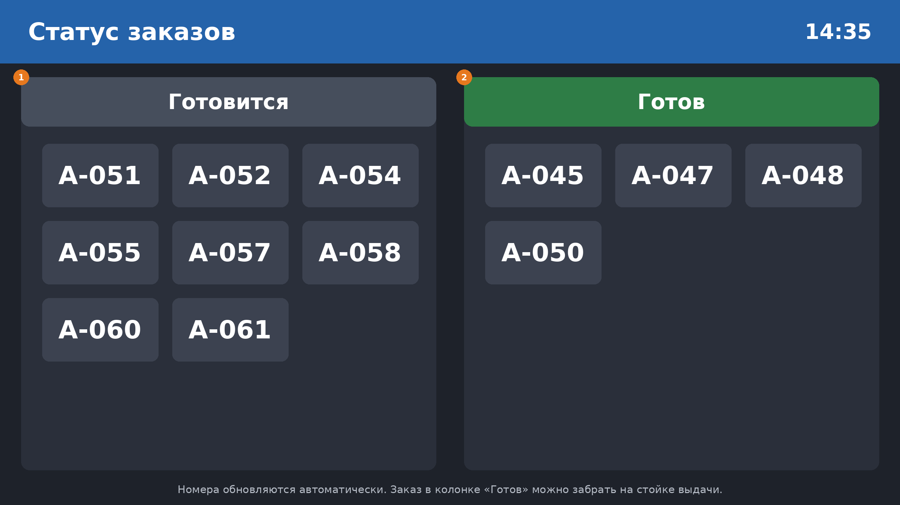
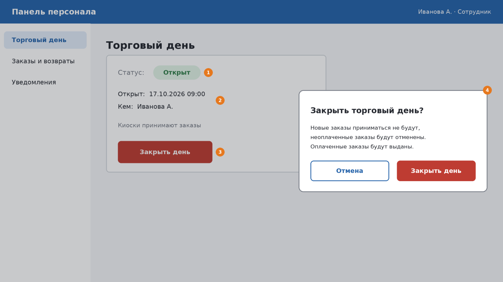
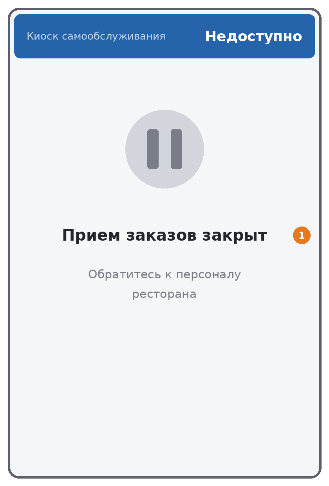

# 5.4. Описание UI и взаимодействие с API

Макеты экранов киоска, табло и панели персонала приведены на рисунках [5.1](#risunok-5-1)–[5.6](#risunok-5-6). Номера в кружках на макетах указаны в [таблице 5.6](#tablitsa-5-6). Мобильное приложение Релиза 1 использует те же ресурсы, что и киоск, кроме оплаты: оплата выполняется онлайн через платежный сервис, перед оплатой гость указывает e-mail для электронного чека, номер заказа показывается на экране приложения.

Рисунок 5.1 — Киоск, корзина
{: #risunok-5-1 .caption }

Рисунок 5.2 — Киоск, оплата: а — выбор способа, б — наличные, в — карта
{: #risunok-5-2 .caption }

Рисунок 5.3 — Киоск: а — заказ оплачен, б — ошибка оплаты, в — фискальный чек с номером заказа
{: #risunok-5-3 .caption }

Рисунок 5.4 — Табло
{: #risunok-5-4 .caption }

Рисунок 5.5 — Панель персонала, закрытие торгового дня
{: #risunok-5-5 .caption }

Рисунок 5.6 — Киоск, прием заказов закрыт
{: #risunok-5-6 .caption }

Таблица 5.6 — Взаимодействие UI с API
{: #tablitsa-5-6 .caption }

| Экран, элемент | Действие | Вызов API | Результат на экране |
| --- | --- | --- | --- |
| Киоск, меню | Открытие меню, выбор категории | GET /menu | Категории, вложенные категории, блюда в продаже с ценами |
| Киоск, состав блюда | Исключение или добавление ингредиента | Данные GET /menu | Доступные изменения состава, цена порции с наценками |
| Киоск, сканирование QR | Гость сканирует QR | POST /loyalty-identifications | Сообщение «QR не распознан» или продолжение заказа; при ошибке внешней системы — анонимный заказ |
| Корзина, [рисунок 5.1](#risunok-5-1), элементы 1–3 | Изменение количества, удаление позиции | Расчет на киоске | Стоимость позиции (2), сумма заказа (5) |
| Корзина, элементы 4, 5 | Переход к проверке заказа | POST /cart-checks | Пересчитанная сумма (5), сообщения об исключенных позициях, добавках и истекших акциях (4) |
| Корзина, элемент 7 | Выбор «В зале» или «С собой» | — | Выбранный способ получения; без выбора кнопка 6 неактивна |
| Корзина, элемент 6 | «Перейти к оплате» | POST /orders | Экран оплаты с суммой из ответа; 409 TOTAL\_CHANGED — сообщение и новая сумма; 409 TRADING\_DAY\_CLOSED — [рисунок 5.6](#risunok-5-6) |
| Оплата, [рисунок 5.2](#risunok-5-2)а, элемент 2; [рисунок 5.2](#risunok-5-2)в, элемент 9 | «Картой», ожидание ответа терминала | POST /orders/{orderId}/payments, POST /payments/{paymentId}/result, GET /kiosk/stream | Экран ожидания без кнопки отмены; при «Успешно» — [рисунок 5.3](#risunok-5-3)а; при отказе — [рисунок 5.3](#risunok-5-3)б |
| Оплата, [рисунок 5.2](#risunok-5-2)а, элемент 3; [рисунок 5.2](#risunok-5-2)б, элементы 5–7 | «Наличными», внесение купюр | POST /orders/{orderId}/payments после внесения суммы | «Внесено» (5), «Осталось внести» (6); при нехватке сдачи — возврат наличных и сообщение (7) |
| [Рисунок 5.2](#risunok-5-2)а, элемент 4; [рисунок 5.2](#risunok-5-2)б, элемент 8; [рисунок 5.3](#risunok-5-3)б | «Отменить заказ» | POST /orders/{orderId}/cancel | Возврат внесенных наличных, стартовый экран |
| Результат, [рисунок 5.3](#risunok-5-3)а, элемент 1; [рисунок 5.3](#risunok-5-3)в | Заказ получил статус «Оплачен» | GET /kiosk/stream, GET /orders/{orderId}, POST /payments/{paymentId}/receipt | Номер заказа (1); печать фискального чека с номером заказа (3); при сбое печати номер остается на экране |
| Ошибка, [рисунок 5.3](#risunok-5-3)б, элемент 2 | «Повторить оплату», «Другой способ оплаты» | POST /orders/{orderId}/payments | Новый платеж выбранным способом |
| Киоск, предупреждение о бездействии | Гость бездействует | POST /orders/{orderId}/cancel, POST /kiosk-incidents | Предупреждение, затем стартовый экран без данных предыдущего гостя; при внесенных наличных — уведомление сотруднику |
| Киоск, [рисунок 5.6](#risunok-5-6) | Торговый день закрыт | GET /trading-day, GET /kiosk/stream | Экран «Прием заказов закрыт», после открытия дня — стартовый экран |
| Табло, [рисунок 5.4](#risunok-5-4), элементы 1, 2 | Смена статуса заказа | GET /board/orders, GET /board/stream | Номер в колонке «Готовится» (1) или «Готов» (2); при потере связи — отметка о неактуальности данных |
| Панель персонала, [рисунок 5.5](#risunok-5-5), элементы 1–4 | «Закрыть день», подтверждение | GET /trading-day, POST /trading-day/close | Статус дня (1), время и сотрудник (2) |
| Панель персонала, «Заказы и возвраты» | Поиск заказа, «Оформить возврат», «Повторить возврат», «Деньги выданы» | GET /staff/orders, POST /orders/{orderId}/refunds, POST /refunds/{refundId}/retry, POST /refunds/{refundId}/cash-confirmation | Статус заказа и возврата |
| Панель персонала, «Уведомления» | Просмотр уведомления, «Повторить передачу» | GET /notifications, POST /orders/{orderId}/kitchen-transfer | Устройство, заказ и вид сбоя; при повторной неудаче — предложение оформить возврат |
