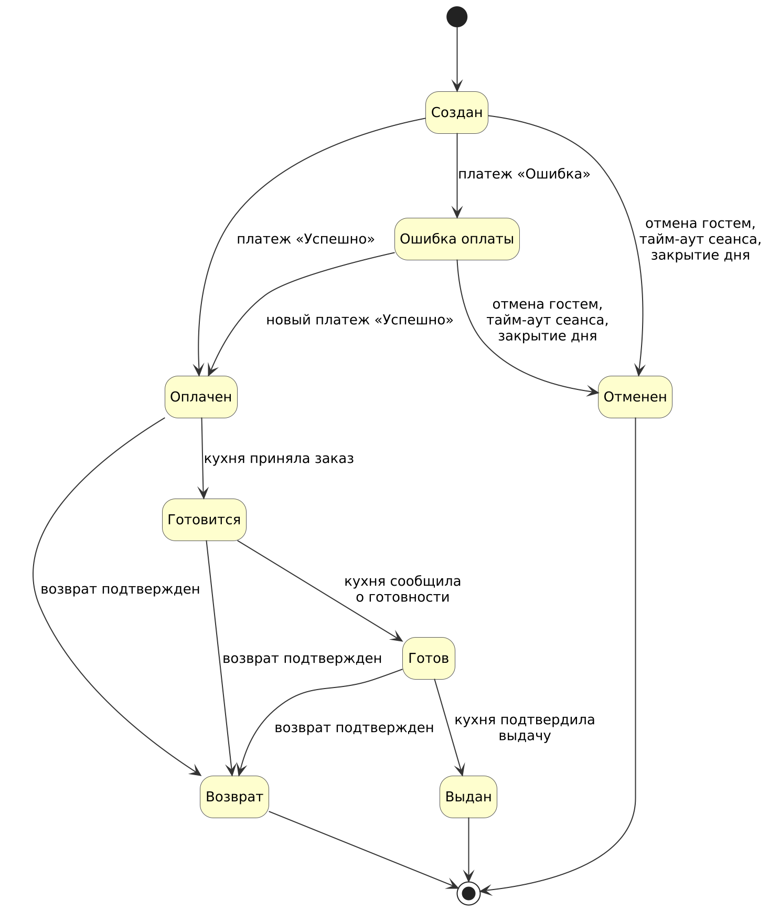

---
hide:
  - toc
  - footer
icon: material/home
---

# Приложение для заказа + табло

Курсовой проект, OTUS «Системный аналитик. Advanced», 2026

Липова Эльвира Евгеньевна · [:fontawesome-brands-telegram: @lipova_ee](https://t.me/lipova_ee)

[Начать читать](01-biznes-trebovaniya/1.1-obekt-avtomatizacii.md){ .md-button .md-button--primary }
[Спецификация API](05-api/5.3-specifikaciya-openapi.md){ .md-button }

## О проекте

Киоск самообслуживания, табло готовности и панель персонала для ресторана быстрого обслуживания. Гость платит через эквайринг, чек уходит в ККТ и ОФД по 54-ФЗ, гость отмечается во внешней лояльности, кухня получает оплаченный заказ.

Эльвира сделала аналитику и проектирование целиком: от бизнес-целей до тест-кейсов.

  21 история
  129 критериев приемки
  24 правила
  16 НФТ
  32 операции API
  114 тест-кейсов
  15 схем

## Что посмотреть за 5 минут

- [2.3. Ограничения и правила](02-trebovaniya/2.3-ogranicheniya-i-pravila.md) — цена, акции, оплата, кухня и торговый день.
- [4.2. Диаграмма компонентов](04-arhitektura/4.2-diagramma-komponentov.md) — системный контекст и контейнеры, C4.
- [5.3. Спецификация OpenAPI](05-api/5.3-specifikaciya-openapi.md) — 32 операции в Swagger UI.
- [7.2. Тест-кейсы MVP](07-proverka/7.2-test-keysy-mvp.md) — проверки историй MVP.

## Схема

Статусная модель заказа, [раздел 3.5](03-informacionnaya-model/3.5-perechisleniya-i-statusnye-modeli.md).

- :material-book-alphabet:{ .lg .middle } __Глоссарий__

    ---

    Термины, которые используются в документе.

    [:octicons-arrow-right-24: Глоссарий](glossariy.md)

- :material-silverware-fork-knife:{ .lg .middle } __1. Бизнес-требования__

    ---

    Цели, метрики, бизнес-процессы и границы проекта.

    [:octicons-arrow-right-24: Раздел 1](01-biznes-trebovaniya/1.1-obekt-avtomatizacii.md)

- :material-file-document-outline:{ .lg .middle } __2. Требования к приложению__

    ---

    Роли, правила, нефункциональные требования и истории.

    [:octicons-arrow-right-24: Раздел 2](02-trebovaniya/2.1-naznachenie-granicy-i-osnovaniya.md)

- :material-graph-outline:{ .lg .middle } __3. Информационная модель__

    ---

    Сущности, связи, кратность и статусные модели.

    [:octicons-arrow-right-24: Раздел 3](03-informacionnaya-model/3.1-naznachenie-modeli.md)

- :material-sitemap:{ .lg .middle } __4. Компонентная архитектура__

    ---

    Компоненты, интеграции и поток заказа до табло.

    [:octicons-arrow-right-24: Раздел 4](04-arhitektura/4.1-obosnovanie-vybora-arhitekturnogo-stilya.md)

- :material-api:{ .lg .middle } __5. Спроектированный API__

    ---

    Ресурсы, контракт POST /orders и экраны.

    [:octicons-arrow-right-24: Раздел 5](05-api/5.1-resursy-i-endpointy.md)

- :material-format-list-checks:{ .lg .middle } __6. Задачи__

    ---

    Критерии готовности и декомпозиция историй.

    [:octicons-arrow-right-24: Раздел 6](06-zadachi/index.md)

- :material-clipboard-check-outline:{ .lg .middle } __7. Проверка требований__

    ---

    Тест-кейсы и чек-лист приемки.

    [:octicons-arrow-right-24: Раздел 7](07-proverka/7.1-podhod-k-proverke.md)

- :material-file-code-outline:{ .lg .middle } __Приложение А__

    ---

    Ссылки на исходный код схем PlantUML.

    [:octicons-arrow-right-24: Приложение А](prilozhenie-a.md)

## Об авторе

Липова Эльвира Евгеньевна, системный аналитик. 6 лет разработки на C# и 1 год системным аналитиком.

[:fontawesome-brands-telegram: Эльвира Липова · От требований к коду](https://t.me/lipova_ee)

Учебный проект курса OTUS «Системный аналитик. Advanced», защита 7 декабря 2026. Ресторан, цифры и сроки смоделированы.

